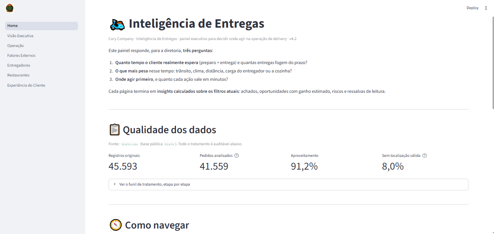
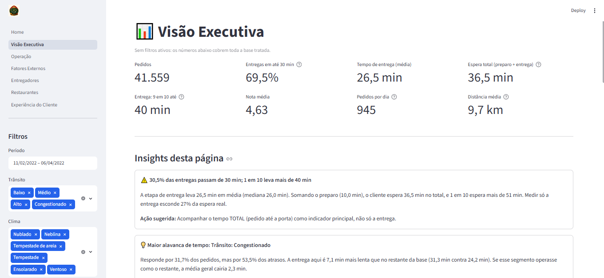
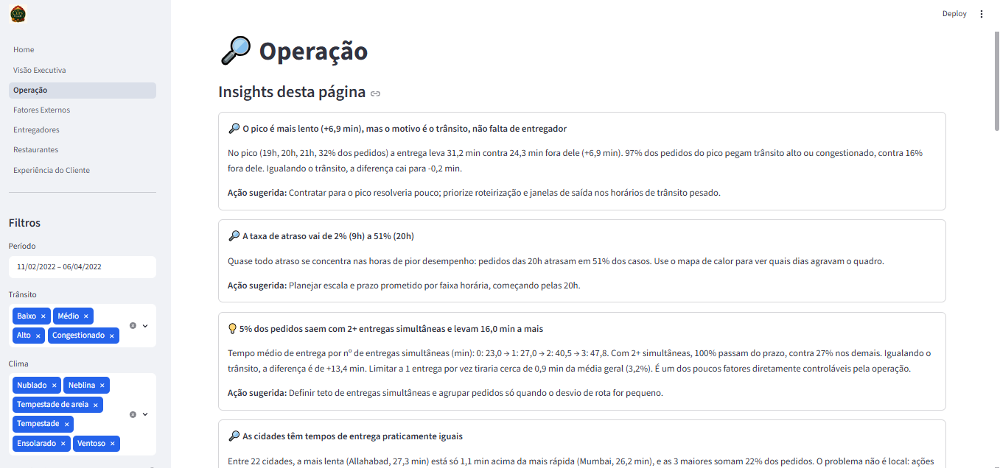
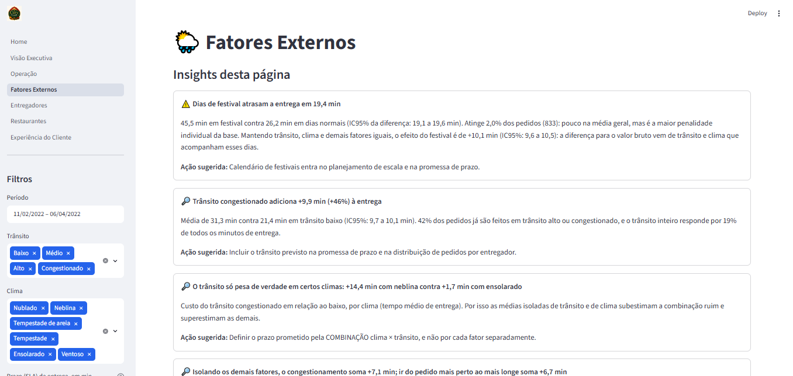
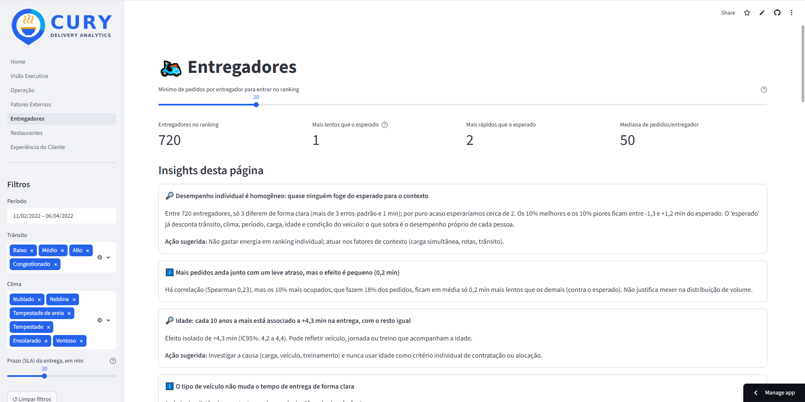
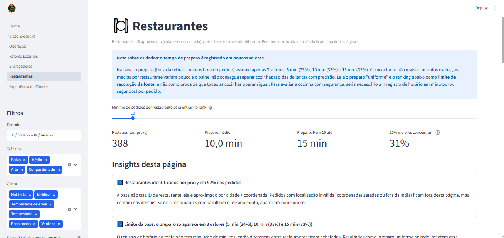
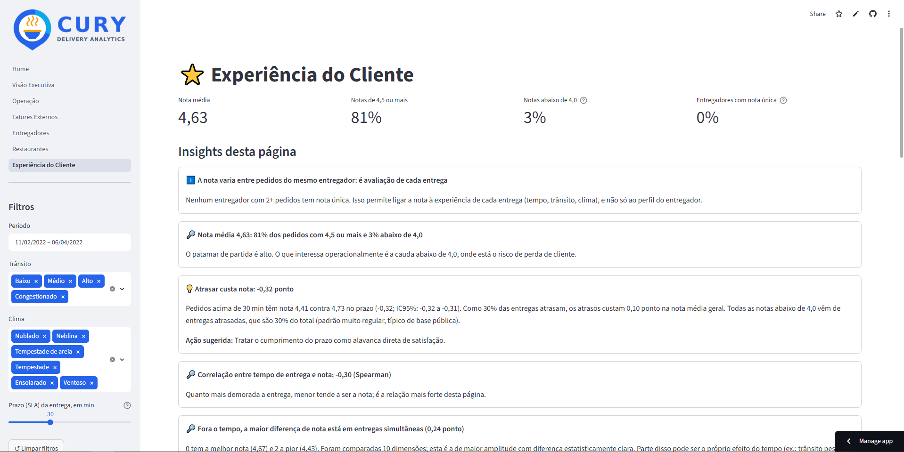

# 🛵 Inteligência de Entregas: onde o tempo se perde e quanto vale recuperá-lo


Painel executivo em **Streamlit + Plotly** que transforma os pedidos de uma operação de delivery na Índia em **decisões**:
mostra quanto tempo o cliente realmente espera, o que mais pesa nessa espera e **quantos minutos cada ação pode recuperar**.

> 🔗 **Demo online:** [Abrir o painel](https://cury-delivery-analytics-ghijfz5ndwznvpqbqn6nux.streamlit.app/)

### Prérevia do painel

---

## Sumário

1. [O problema](#-o-problema)
2. [Perguntas que o painel responde](#-perguntas-que-o-painel-responde)
3. [Demonstração](#-demonstração)
4. [Principais resultados](#-principais-resultados)
5. [Diferenciais técnicos](#-diferenciais-técnicos)
6. [Tratamento dos dados](#-tratamento-dos-dados)
7. [Métricas e metodologia](#-métricas-e-metodologia)
8. [Arquitetura](#-arquitetura)
9. [Como executar](#-como-executar)
10. [Testes](#-testes)
11. [Limitações e cuidados](#-limitações-e-cuidados)
12. [Roadmap](#-roadmap)
13. [Fonte dos dados](#-fonte-dos-dados)
14. [Autor](#-autor)

---

## 🎯 O problema

Uma empresa de delivery (fictícia, **Cury Company**) acompanha a operação por médias de tempo de entrega. Isso esconde três coisas:

- O cliente espera **preparo + entrega**, e a cozinha raramente entra na conta;
- Médias misturam fatores: um entregador "lento" pode só ter pegado rotas longas no trânsito pesado;
- Sem saber **quanto vale** cada problema, a diretoria não sabe por onde começar.

Este projeto constrói a visão que falta ao CEO: tempo real de espera, causas isoladas umas das outras e oportunidades
dimensionadas em minutos.

## ❓ Perguntas que o painel responde

| Página | Pergunta de negócio |
|---|---|
| **📊 Visão Executiva** | Qual o tempo real de espera, quantas entregas atrasam e qual é a maior alavanca de ganho? |
| **🔎 Operação** | Quando a demanda se concentra e a entrega piora? Entregas simultâneas e cidades pesam? |
| **🌦️ Fatores Externos** | Quanto custam trânsito, clima e festivais, **isolando um do outro**? |
| **🛵 Entregadores** | Quem foge do esperado **para o próprio contexto**, e quanto isso vale? |
| **🍽️ Restaurantes** | A cozinha é gargalo? A demanda depende de poucos parceiros? |
| **⭐ Experiência do Cliente** | O que se associa a notas menores? A nota é confiável como termômetro? |

Todas as páginas têm filtros globais (**período, trânsito, clima e prazo/SLA**) que valem para gráficos, KPIs **e insights**.

## 🖼️ Demonstração

| Visão Executiva | Operação | Fatores Externos |
|:---:|:---:|:---:|
|  |  |  |

| Entregadores | Restaurantes | Experiência do Cliente |
|:---:|:---:|:---:|
|  |  |  |


## 📈 Principais resultados

Os números abaixo **não são digitados à mão**: o script `scripts/update_findings.py` roda o mesmo motor de insights do painel
sobre a sua base real (sem filtros, prazo de 30 min) e preenche este bloco. Veja o relatório completo, com detalhes e ações
sugeridas, em [`docs/RESULTADOS.md`](docs/RESULTADOS.md).

<!-- FINDINGS:START -->
> Gerado automaticamente a partir de `train.csv`: 45.593 registros brutos, 41.559 pedidos analisados (91,2%), prazo de entrega de 30 min, sem filtros.

**Visão Executiva**

- ⚠️ **30,5% das entregas passam de 30 min; 1 em 10 leva mais de 40 min**
- 💡 **Maior alavanca de tempo: Trânsito: Congestionado**
- 💡 **Maior alavanca sob gestão direta: Entregas simultâneas: 2 simultâneas**
- 💡 **O preparo é 27% da espera do cliente**
- 🔎 **Últimos 7 dias da base: tempo de entrega ficou estável (+0,8 min) com volume -2%**

**Operação**

- 🔎 **O pico é mais lento (+6,9 min), mas o motivo é o trânsito, não falta de entregador**
- 🔎 **A taxa de atraso vai de 2% (9h) a 51% (20h)**
- 💡 **5% dos pedidos saem com 2+ entregas simultâneas e levam 16,0 min a mais**
- 🔎 **As cidades têm tempos de entrega praticamente iguais**

**Fatores Externos**

- ⚠️ **Dias de festival atrasam a entrega em 19,4 min**
- 🔎 **Trânsito congestionado adiciona +9,9 min (+46%) à entrega**
- 🔎 **O trânsito só pesa de verdade em certos climas: +14,4 min com neblina contra +1,7 min com ensolarado**
- 🔎 **Isolando os demais fatores, o congestionamento soma +7,1 min; ir do pedido mais perto ao mais longe soma +6,7 min**
- 🔎 **Neblina é o clima mais custoso: +6,1 min por entrega, em média**
- 💡 **Fator categórico de maior peso: Trânsito: Congestionado (+2,3 min na média geral)**
- 🔎 **Pior combinação: neblina + trânsito congestionado (36,9 min)**

**Entregadores**

- 🔎 **Desempenho individual é homogêneo: quase ninguém foge do esperado para o contexto**
- 🔎 **Idade: cada 10 anos a mais está associado a +4,3 min na entrega, com o resto igual**
- 🔎 **Condição do veículo: +1 nível está associado a -2,3 min na entrega**

**Restaurantes**

- 🔎 **Demanda pulverizada: 20% dos restaurantes fazem 31% dos pedidos**
- 🔎 **Preparo médio de 10,0 min: 27% da espera total do cliente**
- 🔎 **Poucos restaurantes preparam mais devagar, e o ganho de corrigi-los é irrelevante**
- 🔎 **Preparo lento não é compensado nem agravado na entrega**

**Experiência do Cliente**

- 🔎 **Nota média 4,63: 81% dos pedidos com 4,5 ou mais e 3% abaixo de 4,0**
- 💡 **Atrasar custa nota: -0,32 ponto**
- 🔎 **Correlação entre tempo de entrega e nota: -0,30 (Spearman)**
- 🔎 **Fora o tempo, a maior diferença de nota está em entregas simultâneas (0,24 ponto)**
<!-- FINDINGS:END -->

> Interpretação sobre os dados: A base pública tem aparência de dados sintéticos (distribuições muito regulares). Os resultados
> demonstram o **método**; em uma operação real, o mesmo painel se alimenta de dados reais sem alterações.

## 🧠 Diferenciais técnicos

- **Insights calculados, não escritos.** Cada página gera achados, oportunidades, riscos e ressalvas a partir do recorte filtrado,
  com ação sugerida e ganho em minutos. Recortes pequenos geram aviso em vez de conclusão frágil.
- **Efeito isolado por regressão** (OLS com erros robustos HC1): "o congestionamento equivale a *X km* a mais de distância"
  só é possível separando trânsito, clima, distância e carga.
- **Entregadores comparados no próprio contexto**: ranking de *excesso vs. esperado*, com classe só quando a diferença é clara
  **e** de pelo menos 1 minuto; evita premiar ou punir sorte de rota.
- **Dimensionamento de oportunidades**: "se este segmento operasse como o restante, a média geral cairia *X* min", separando o que é
  controlável (entregas simultâneas, escala) do que não é (trânsito, clima).
- **Incerteza visível**: barras de erro de 95% nos gráficos, tamanho mínimo de amostra e aviso quando a nota parece ser atributo do entregador.
- **Tratamento auditável**: funil de limpeza com a contagem de cada etapa, exibido na Home.
- **Portável e testado**: caminhos relativos, uma única variável de ambiente opcional e suíte de testes que recupera efeitos plantados em dados sintéticos.

## 🧹 Tratamento dos dados

Fonte: `train.csv` (20 colunas por pedido). Regras completas em [`docs/DICIONARIO_DE_DADOS.md`](docs/DICIONARIO_DE_DADOS.md).

| Problema na base bruta | Tratamento |
|---|---|
| Espaços sobrando e textos `NaN ` | Padronização e conversão para ausência real |
| `conditions Sunny`, `(min) 24`, `Metropolitian` | Prefixos removidos, número extraído, grafia corrigida |
| Latitude/longitude com **sinal invertido** | Corrigidas (a Índia está no hemisfério Norte/Leste) |
| Coordenadas **zeradas** ou fora da Índia | Pedido mantido, marcado `has_valid_location = False`, sem distância |
| Pedidos duplicados | Mantido o primeiro por `ID` |
| Campos essenciais ausentes | Linha removida (imputar distorceria os efeitos medidos) |
| Valores impossíveis (idade fora de 18–60, nota fora de 1–5, preparo fora de 0–90 min…) | Linha removida |
| Festival sem informação | Mantido; fora só da comparação de festivais |
| Não há ID de restaurante | Proxy: cidade + coordenada (limitações em `docs/METODOLOGIA.md`) |
| Preparo com poucos valores distintos (5, 10, 15 min) | Mantido; o painel avisa que é limite de resolução da fonte |
| `City` é, na verdade, o **tipo de área** | Renomeado para `area_type`; a cidade real vem do código no ID do entregador |

Novas variáveis: tempo de preparo, **tempo total**, distância e velocidade, hora, dia da semana, período do dia, faixas de idade e de tempo.
O funil completo (linhas removidas por etapa) aparece na **Home** do painel.

## 📐 Métricas e metodologia

| Métrica | Por quê |
|---|---|
| **Espera total** (preparo + entrega) | É o que o cliente sente. |
| **% no prazo** com SLA ajustável | "Atraso" é decisão de negócio, não constante. |
| **P90 do tempo** | A média esconde a cauda. |
| **Ganho potencial (min)** | Converte diferenças em prioridade de ação. |
| **Excesso vs. esperado** | Compara entregadores no mesmo contexto. |
| **Concentração (Pareto)** | Dependência de poucos restaurantes. |

Detalhes, fórmulas e decisões descartadas: [`docs/METODOLOGIA.md`](docs/METODOLOGIA.md).

## 🏗️ Arquitetura

```
.
├── Home.py                     # contexto do projeto e qualidade dos dados
├── pages/                      # uma página por visão (Streamlit multipage)
│   ├── 1_Visão_Executiva.py
│   ├── 2_Operação.py
│   ├── 3_Fatores_Externos.py
│   ├── 4_Entregadores.py
│   ├── 5_Restaurantes.py
│   └── 6_Experiência_do_Cliente.py
├── src/
│   ├── config.py               # caminhos, limites de qualidade, mapa de cidades
│   ├── processing/             # loader → cleaning → features → pipeline (+ filtering)
│   ├── metrics/                # estatística, regressão, KPIs, segmentos, entregadores, restaurantes…
│   ├── insights/               # motor de insights por página (funções puras, testáveis)
│   ├── visuals/                # gráficos Plotly e tema
│   ├── ui/                     # filtros, logo, componentes, layout, cache
│   ├── utils/                  # formatação pt-BR e rótulos
│   └── reporting.py            # gera o bloco "Principais resultados"
├── scripts/                    # update_findings.py, diagnostico.py
├── tests/                      # pytest + gerador de dados sintéticos
├── docs/                       # dicionário de dados, metodologia, imagens
├── data/                       # ← coloque aqui o train.csv (pasta vazia no repositório)
├── assets/                     # ← coloque aqui o Logo.png (opcional)
└── .streamlit/config.toml
```

Princípios: **processamento, métricas e insights não importam Streamlit** (testáveis em isolamento); a interface só desenha.

## 🚀 Como executar

Requisitos: **Python 3.10+**.

**1. Clone e entre na pasta**

```bash
git clone <link-do-repositório>
cd cury-delivery-analytics
```

**2. Crie o ambiente e instale as dependências**

```powershell
# Windows (PowerShell)
python -m venv .venv
.venv\Scripts\Activate.ps1
pip install -r requirements.txt
```

```bash
# macOS / Linux
python3 -m venv .venv
source .venv/bin/activate
pip install -r requirements.txt
```

**3. Coloque a base em `data/`**

Copie o arquivo **`train.csv`** para a pasta `data/` (o nome deve ser `train`; `.csv`, `.xlsx` e `.xls` são aceitos).
Para usar outro local sem mover o arquivo, defina `DELIVERY_DATA_PATH` com o caminho completo.

**4. (Opcional) Logo**: salve o logotipo como `assets/Logo.png`.

**5. Abra o painel**

```bash
streamlit run Home.py
```

**6. (Opcional) Preencha os resultados deste README com os seus dados**

```bash
python scripts/update_findings.py
python scripts/diagnostico.py    # funil de limpeza e checagens de sanidade no terminal
```

> Se faltar o `train.csv`, o painel não quebra: mostra uma mensagem dizendo exatamente onde colocá-lo.

## ✅ Testes

```bash
pip install -r requirements-dev.txt
pytest
```

A suíte usa **dados sintéticos no formato bruto do `train`** (com as mesmas sujeiras: espaços, `NaN `, sinais invertidos, zeros)
e efeitos conhecidos, para verificar que:

- o funil de limpeza fecha as contas e as correções acontecem (sinal de coordenada, prefixos, duplicados, virada de meia-noite);
- a regressão recupera os efeitos plantados (por exemplo, trânsito congestionado ≈ +10 min);
- a classificação de entregadores exige diferença clara e relevante;
- todo insight é gerado sem erro em recortes normais, minúsculos, sem modelo e filtrados;
- os gráficos montam com Plotly real (o teste é ignorado automaticamente se o Plotly não estiver instalado).

## ⚠️ Limitações e cuidados

- **Associação não é causalidade.** Efeitos isolados vêm de regressão e podem refletir fatores não medidos.
- **Restaurante é um proxy** (cidade + coordenada); pedidos sem localização válida ficam fora da página de restaurantes.
- **O tempo de preparo tem baixa resolução.** Na base, ele assume só poucos valores (5, 10 e 15 min), pois os horários não trazem minutos exatos. Isso é um limite da fonte, não um erro do painel: as médias por restaurante ficam achatadas e o resultado "preparo uniforme na rede" não prova que as cozinhas são iguais. O painel detecta o padrão e exibe uma nota na página Restaurantes. Para gerir a cozinha, o ideal é registrar horários em minutos exatos.
- **A nota pode ser do entregador, não da entrega.** O painel mede isso (`Entregadores com nota única`) e avisa quando ocorre.
- **A escala `Vehicle_condition` (0–3) não é documentada**; o painel mostra o efeito mas pede confirmação do sentido.
- **Base de uso didático**: padrões muito regulares limitam o que se pode generalizar.
- Distância é **em linha reta**, não de rota.

## 🗺️ Roadmap

- [ ] Previsão do tempo de entrega no momento do pedido (modelo preditivo com validação temporal)
- [ ] Simulador de cenários: "e se limitarmos entregas simultâneas a 1?"
- [ ] Comparação entre períodos (semana contra semana) com teste de significância
- [ ] Integração com dados de rota (distância real) e avaliação por pedido
- [ ] Deploy automatizado (Streamlit Community Cloud) com testes em CI

## 📚 Fonte dos dados

Base pública **`train`** (`train.csv`), conjunto de dados de entregas de comida na Índia amplamente distribuído em plataformas
de dados abertos. O arquivo train.csv está incluído em data/ para que o painel online funcione

## 👤 Autor

**Igor Mendes**
&nbsp;·&nbsp; [LinkedIn](www.linkedin.com/in/igor-mendes-a50550239) &nbsp;·&nbsp; [GitHub](https://github.com/Ig0rMendes) &nbsp;·&nbsp; igorsamendes13@gmail.com
